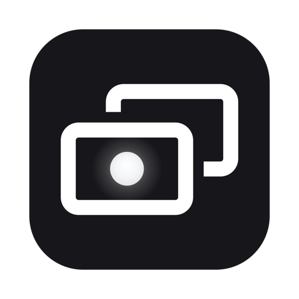

<p align="center">
	
</p>

# MokaScreen

Turn a second MacBook into a low-latency extended display for the first, over a
Thunderbolt cable.

MokaScreen adds a real extended display to the Mac you work on, then streams it —
uncompressed, pixel for pixel — to the other Mac's screen. No video encoder, no
driver, no kernel extension.

## Requirements

- Two **MacBooks**.
- **macOS 27.2 or later** on both.
- A **Thunderbolt 4 or 5 cable** between them.

Two MacBook Pros with Thunderbolt 5 (M4 or M5 Pro or Max) are best. Over Thunderbolt 4 —
a Thunderbolt 4 cable, or a Mac with Thunderbolt 4 ports — the picture is just as
sharp, but whole-screen changes (switching Spaces, full-screen video) need more than
Thunderbolt 4 networking carries at 120 Hz, so those drop below 120 frames per second.

The extended display runs at the display Mac's refresh rate: up to 120 Hz on a
ProMotion screen, 60 Hz on a MacBook Air. MokaScreen has been tested on two 16-inch
MacBook Pros with M5 Max.

## Setting up the two Macs

Do this once on each Mac.

1. **Connect the cable.** In System Settings › Network, the *Thunderbolt Bridge*
	service should show as connected. MokaScreen uses only this link and never your
	Wi-Fi.
2. **Install MokaScreen** in /Applications and open it.
3. **Pick a role.**
	- On the Mac you work on: **Extend this Mac**. macOS asks for *Screen Recording*
		permission; allow it, then quit and reopen MokaScreen when macOS offers.
	- On the other Mac: **Be the display**. macOS asks to allow *Local Network*
		access; allow it.
4. On the Mac you work on, open **Arrange Displays…** and drag the *MokaScreen*
	display to the side where the other MacBook sits. macOS remembers this.

From then on MokaScreen remembers each Mac's role and connects by itself when it
opens. On the display Mac, switching to another app pauses the picture and switching
back to MokaScreen resumes it; press **Esc** to get your screen back.

### If one Mac is managed by your employer

MokaScreen is an ordinary app: no kernel extension, no system extension, no
special entitlement. Make the **managed Mac the one you work on**, because that
side only makes outgoing connections. The display side listens for a connection,
which a managed firewall may block.

If your organisation's MDM profile blocks Screen Recording for unlisted apps,
the sender cannot capture the extended display; ask IT to allow
`com.gigarip.mokascreen`.

## Display size and shape

The extended display takes the size of the display Mac's screen, so every pixel
lands on exactly one pixel there: **3456 × 2234** ("looks like 1728 × 1117") from a
16-inch MacBook Pro, **3024 × 1964** ("looks like 1512 × 982") from a 14-inch one,
at that screen's refresh rate up to 120 Hz. If the display Mac uses a scaled
resolution such as *More Space*, the extended display matches that instead.

The display Mac publishes its screen's size, notch, and refresh rate on the
Thunderbolt Bridge. When the Mac you work on connects to a display Mac whose screen
differs from the last one, it recreates the extended display at the new size before
the picture appears: its windows move to your main screen and macOS puts the
display back where you arranged it. Changing the display Mac's resolution while it
is showing the picture takes effect the next time it connects; until then the
picture is scaled to fit.

The display Mac's notch covers a sliver of the extended display's menu bar. If
that bothers you, choose **Below the notch** before starting; the display Mac then
shows a black band behind the notch.

## How it works

```
Mac you work on                                          Display Mac
───────────────                                          ───────────
CGVirtualDisplay (HiDPI, 120 Hz)
  └─ ScreenCaptureKit, 120 fps, BGRA, dirty rects
       └─ DirtyRegion (tile grid, latest-frame-wins)
            └─ one TCP connection over bridge0 ─────────► recv straight into
               (Nagle off, writev from the                GPU-shared buffers (8)
                capture buffer, no copy)                    └─ held until due (Smooth Motion)
                                                                 └─ blit into display texture
                                                                      └─ present on a refresh, 120 Hz
                ◄──────────────── "presented" acks ───────────── (up to three drawables in flight)
```

- **Bandwidth.** A full frame is ~31 MB; 120 Hz raw is ~30 Gbps and a single TCP
	stream over Thunderbolt 5 measured ~69 Gbps, so frames go out uncompressed.
- **Dirty rectangles** cut latency rather than bandwidth: a typing update is a few
	kilobytes instead of 3.6 ms of wire time.
- **Latest-frame-wins.** If the network stalls, newer captures replace the waiting
	one and their changed areas merge, so the display catches up in one step.
- **Presenting on the display Mac.** With Smooth Motion (on by default) each frame
	waits in its receive buffer until a refresh before its scheduled time, capture
	time plus a fixed delay, then is presented on the panel's next refresh, so frames
	reach the glass spaced as they were captured. A drawable stops counting as in
	flight when macOS reports it on the glass, or one refresh after its scheduled
	time if no report comes. While nothing changes, the display Mac presents the
	unchanged picture every 250 ms: after about a second of stillness, macOS 27.2
	otherwise never reports the first one or two frames presented, which held up
	the frames behind them. The display Mac also holds its panel at 120 Hz while
	showing, because macOS sometimes ran it at 60 Hz under load.
- **Discovery** is Bonjour, pinned to the Thunderbolt Bridge interface. The
	display Mac's listening socket is pinned there too, so it cannot be reached over
	Wi-Fi.

The full design brief is in [`Docs/DESIGN_BRIEF.md`](Docs/DESIGN_BRIEF.md).

## Developing

Open `MokaScreen.xcodeproj` in Xcode, or:

```bash
xcodebuild -project MokaScreen.xcodeproj -scheme MokaScreen -derivedDataPath build/DerivedData test
```

The tests cover the wire format, the dirty-region tiling, a full
sender → TCP → receiver round trip that checks every pixel, Smooth Motion's
pacing, keeping settings the same on both Macs, frame timing recordings, and the
bookkeeping of drawables in flight.

### Trying it on one Mac

**Develop › Start Loopback Test** (or launch with `--loopback-test`) runs both
sides in one process over loopback, with the received display in a window.

### Measuring

- **Statistics.** **Develop › Show Statistics** (⌥⌘S) shows, on the Mac you work
	on, capture/send rates, the share of the screen sent per frame, and capture →
	on-glass latency, measured from the display Mac's presentation callback and
	split into capture + cable, Smooth Motion's hold, and the display Mac's own
	share. Its colour is green within two refreshes beyond Smooth Motion's delay.
	*Record statistics to a CSV file* writes one row per second to
	`~/Library/Logs/MokaScreen/` for studying real workloads.
- **Glass-to-glass latency.** **Develop › Show Latency Clock** (⌥⌘L) puts a
	millisecond clock on every screen, including the extended one.
	Film both MacBooks with a high-speed camera and subtract the readings in one
	video frame.
- **Smooth Motion.** On by default; **Develop › Smooth Motion** (⌥⌘M), on either
	Mac and kept the same on both, turns it off. The display Mac presents each frame
	at its capture time plus a fixed delay, on one of its own refreshes, instead of
	as soon as it arrives, so frames reach the glass spaced as they were captured
	even though large frames, such as a scroll's, take uneven times on the cable.
	The delay follows the 99th-percentile spread of frame trips over the last
	second, up to 30 ms. **Develop › Smooth Motion Minimum Delay** sets a floor under
	it (20 ms by default; also Adaptive, 10, 25 or 30 ms), which also covers the
	first frames of a scroll, before the adaptive delay has risen. *Uneven frames*
	in the statistics counts frames whose spacing on the glass differed from their
	capture spacing by more than half a refresh.
- **Frame timing.** **Develop › Record Frame Timing** (⌥⌘T), on the Mac you work
	on while connected, records 10 seconds of every frame's capture, send,
	arrival, draw, scheduled, and glass times on both Macs, and writes one CSV row
	per capture to `~/Library/Logs/MokaScreen/`.
- **Fixed 120 Hz.** **Develop › Fixed 120 Hz** (⌥⌘R), on by default, holds the
	display Mac's panel at 120 Hz while showing; turned off, ProMotion chooses the
	rate. Smooth Motion lines frames up with the panel's refreshes only while it
	is on.
- **Dirty-rectangle audit.** `defaults write com.gigarip.mokascreen AuditDirtyRects -bool YES`
	makes the sender diff every captured frame against the previous one and log
	any changed tile ScreenCaptureKit did not report.
- **Logs.** `log stream --info --predicate 'subsystem == "com.gigarip.mokascreen"'`

### Releasing

`./release.sh <x.y.z>` publishes a release, the same way MokaRig does. From a
clean, pushed checkout, it:

1. archives, signs with Developer ID, and builds a DMG;
2. notarizes and staples the DMG;
3. uploads it to the `mokascreen-downloads` R2 bucket as `MokaScreen-<x.y.z>.dmg`
	and as the stable `MokaScreen.dmg` that mokascreen.com links to;
4. renders `ReleaseNotes/<x.y.z>.md` and publishes a signed Sparkle `appcast.xml`,
	which installed copies check for updates;
5. tags the commit `v<x.y.z>`.

With no version, it releases the next patch after the published one. Write the
release notes first; the script refuses to run without them.

`./build-release.sh` makes a notarized zip in `~/MokaScreenReleases/Builds` for
trying a build on another Mac without publishing it.

## License

MokaScreen is dual-licensed under the [MIT License](LICENSE-MIT) or the
[Apache License, Version 2.0](LICENSE-APACHE), at your option.
